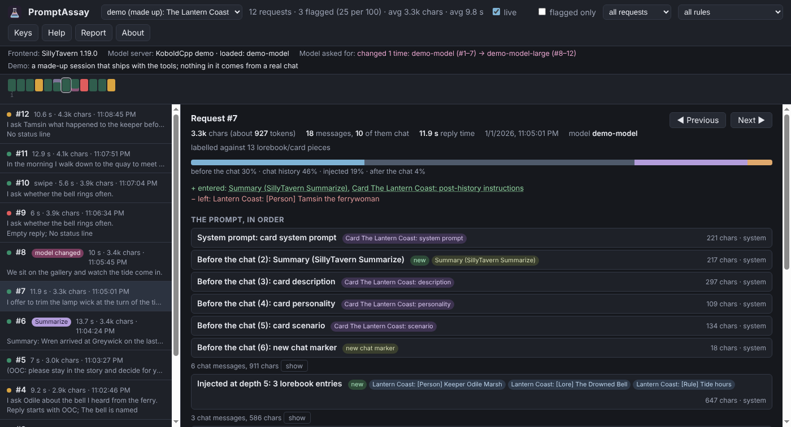
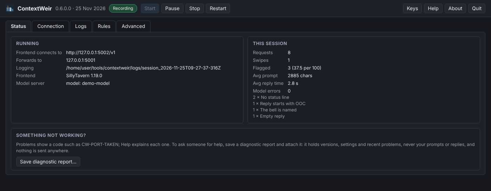

# ContextWeir and PromptAssay

<!-- ContextWeir 0.6.0.0 and PromptAssay 0.4.1.0, built 25 Nov 2026. Part of the Wellspring tools.
     Directed by Harahel-Whot. Written by Claude Opus 5.5 (Anthropic).
     Licence: CC BY 4.0 (see LICENSE.txt). Source: https://github.com/Harahel-Whot/contextweir -->

Two small, free tools for seeing exactly what your chat frontend sends to your AI model.

- **ContextWeir** is the recorder. It sits between SillyTavern (or any OpenAI-compatible frontend)
  and your model server, passes everything through unchanged, and saves each request and reply
  exactly as sent. It checks every turn against flag rules you can switch on, off or write
  yourself. You run it from its control panel.
- **PromptAssay** is the reader. It opens those logs in a window and takes each request apart:
  every message as a labelled section with its size, which lorebook entries and card fields are in
  it, what entered or left since the previous turn, and where the flag rules fired.

Both need [Node.js](https://nodejs.org), version 18 or newer. Nothing else is installed: no
packages, no downloads. Each opens as its own app-style window (Edge or Chrome) or, if neither
browser is found, as a normal browser tab.

**Status:** early versions ("prototype"). Built and tested on Windows 11 with SillyTavern 1.19.0
and KoboldCpp 1.124. Mac and Linux launchers are included but untested.

## Getting started

1. Download: the green **Code** button on GitHub, then **Download ZIP**, and unzip it anywhere
   (not in Program Files).
2. **Windows:** double-click `Create Shortcuts (Windows).bat` once. It makes a ContextWeir and a
   PromptAssay shortcut, with their icons, in this folder (and on your desktop if you say yes).
   From then on, double-click a shortcut.
   Without shortcuts, each tool's folder has one file to double-click: `Start ContextWeir.bat` or
   `Start PromptAssay.bat`. If the tool is already running, it just opens the window again.
3. **Mac:** `launch/mac/` in each tool's folder (first time: right-click > Open).
   **Linux:** `launch/linux/` in each tool's folder.

### Try PromptAssay first (nothing to set up)

PromptAssay ships with a made-up demo story, "The Lantern Coast", so you can try it before you
record anything. Start PromptAssay and pick **demo (made up): The Lantern Coast** from the sessions
list. Click any request on the left; click a tag on a section (a lorebook entry, a card field) to
see exactly what it put into the prompt. Arrow keys move between requests. To hide the demo later,
set `"showDemo": false` in `promptassay/settings.json`.

### Record with ContextWeir

1. Start ContextWeir. Its control panel opens on the start screen. On the **Connection** tab,
   check the receiving port and test the model server, then press **Start**.
2. In SillyTavern, point the API address at `http://127.0.0.1:5002/v1` (ContextWeir's receiving
   port; the Connection tab shows it and lets you change it) instead of your model server's own
   address.
3. Play a few turns. PromptAssay shows the new session at the top of its list.
4. To stop: point SillyTavern back at your model server and press **Quit** in the panel. While
   ContextWeir is closed, nothing answers on that port.

Both windows have a **Help** button (the full guide; the same text is `help.html` in each tool's
folder) and an **About** button.

## The control panel (ContextWeir)

- **Buttons:** Start (opens the receiving port, new session), Pause / Resume (turns still pass
  through, nothing is saved), Stop (closes the port; the panel stays), Restart (applies saved
  settings, new session), Quit (closes ContextWeir, its console and the panel window). Closing only
  the panel window keeps ContextWeir recording; its Start file brings the panel back.
- **Tabs:** Status, Connection, Logs, Rules, Advanced. Each setting says "applies now" or "needs
  Restart".
- **"Skip this screen next time"** starts recording as soon as ContextWeir opens.
- **Keyboard:** Alt+S start, Alt+P pause/resume, Alt+R restart, Alt+1-5 tabs, `?` for the list.
  In PromptAssay: arrows between requests (Shift for flagged ones), Home/End, F flagged only,
  L live, E open all sections, `?` for the list.

### Model servers on another computer

By default ContextWeir talks only to a model server on the same computer. On the Connection tab
you can allow one on another computer or a cloud service. Before anything is sent there, a warning
explains the risk (your whole chats cross the network) and you confirm it for that address. https
certificates are always checked; your API key is passed on but never saved.

## Flag rules

A flag rule looks at each turn and marks it when something is off, for example a reply that starts
in the wrong place or a prompt that lost a section. Manage them on the panel's **Rules** tab:

- Tick or untick a rule, or a whole set, to switch it on or off. Changes save straight away.
- The rule editor is dropdowns: *[the reply] [contains] [text]*. Patterns (regex) are the advanced
  tests. Add exceptions ("...unless the last message starts with ...") and a note saying why the
  rule exists.
- Export all sets, or one, as a small `.json` file to share. Import shows what a file holds, and
  what will be refused, before anything is saved.
- Ready-made sets are in `contextweir/rule_sets/` (General, plus one for the Wellspring game).
- Rules run with a time limit; a rule that takes too long is stopped and switched off.

## Settings and logs

| File | What it holds |
| --- | --- |
| `contextweir/settings.json` | ports, the model server address, the log folder, how many sessions to keep, size limits and the start screen. Change them on the panel's tabs; bad values are refused, with reasons. |
| `contextweir/rules.json` | your flag rules (data only, never code) |
| `promptassay/settings.json` | which log folders to read, and where your SillyTavern lorebooks and character cards are (used only to label content; read-only) |

These three files are yours and are not included in the download. If one is missing, the tool
starts with its defaults; ContextWeir then has no flag rules until you import a set from
`contextweir/rule_sets/` on the Rules tab.

**Logs:** `contextweir/logs/session_<date-time>/records.jsonl` holds one JSON object per request
(the request exactly as sent, the reply, timings and flags); `summary.json` holds the session's
numbers and the SillyTavern and model server versions. The format is described in the Help pages
and in [AI_HELPERS.md](AI_HELPERS.md).

**Moving to another computer:** the panel's Advanced tab exports your settings and rules as one
file, and imports one with a preview of every change.

### Supported APIs

Chat Completion, Text Completion and KoboldCpp's own API are recorded. llama.cpp's `/completion`
and Ollama's `/api/generate` are supported but untested. Requests to other addresses still pass
through, but are not saved, and ContextWeir says so. PromptAssay takes text-completion prompts apart
using SillyTavern's instruct templates or the speakers' names.

## Privacy and security

Logs hold your full prompts and replies in plain text: everything you typed, and everything in your
cards and lorebooks, secrets included. They stay on your computer. Keep the logs folder private and
check a screenshot before you share it.

- Both tools listen only on 127.0.0.1 (this computer).
- A web page open in your browser cannot read your logs or change settings through them.
- Only ContextWeir's own window can change its settings or rules.
- PromptAssay only reads, apart from remembering "Don't show this again".
- No packages, no auto-update, nothing sent anywhere you did not choose.

Never expose SillyTavern or these tools to the internet. If you use remote access (for example
Tailscale), keep SillyTavern's whitelist or login on. More in [SECURITY.md](SECURITY.md).

## When something goes wrong

Every known problem has a short code (`CW-...` or `PA-...`) shown beside the message. Each Help page
has a table of codes: what each means and what to do.

To ask for help, use ContextWeir's Status tab, **Save diagnostic report**, or PromptAssay's
**Report** button. You see the whole report before it is saved. It holds versions, settings and
counts, never your prompts, replies or lorebook text, and nothing is sent anywhere.

Checking files by hand: in the `contextweir` folder, `node contextweir.js --check` lists any problem
in `settings.json` and `rules.json` and changes nothing.

Using an AI assistant to help you? Point it at [AI_HELPERS.md](AI_HELPERS.md).

## Known limits

- PromptAssay reads a whole session file when it opens it: very long sessions take a few seconds.
- Tested on Windows only so far.
- PromptAssay can also read runs of the earlier Wellspring logger; most people can ignore that
  (they are marked "(old logger)").

## Feedback

Issues and ideas: https://github.com/Harahel-Whot/contextweir/issues

Design and direction by Harahel-Whot; code, docs and testing written with Claude (Anthropic).
Licence: MIT for the code, CC BY 4.0 for the help, docs and icons (see [LICENSE.txt](LICENSE.txt)).
Provided as is, with no warranty. Not made by or affiliated with SillyTavern, KoboldCpp or
Anthropic.
